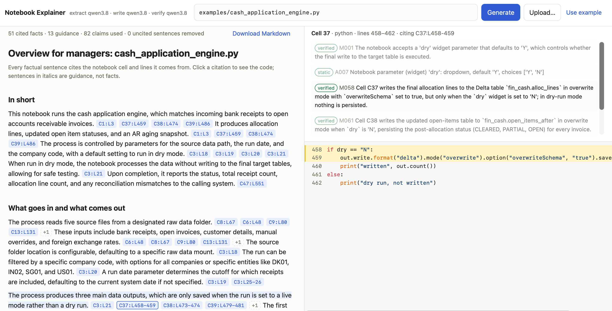
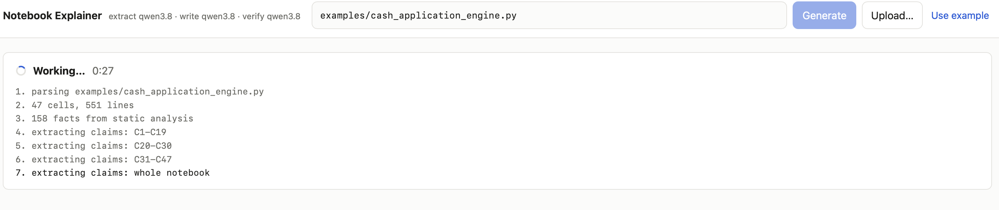
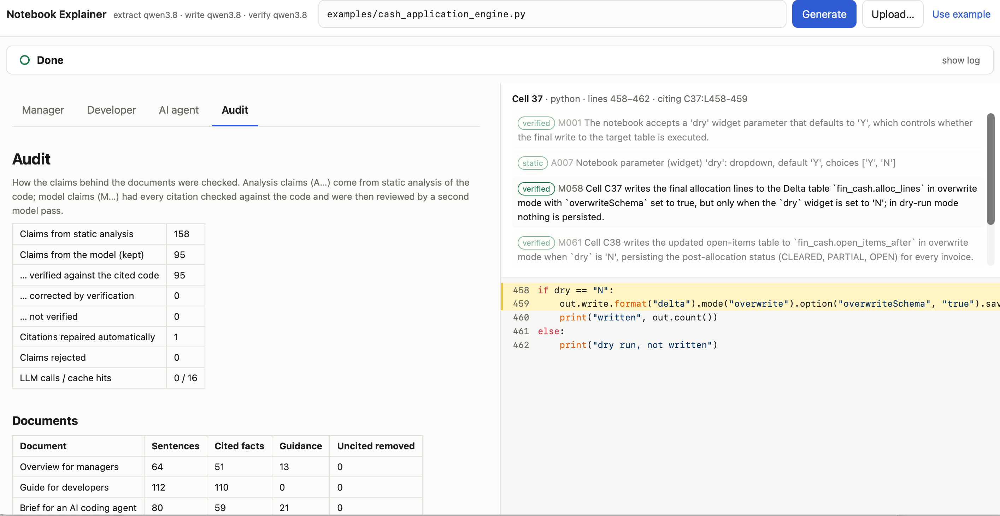

# nb-expl: Notebook Explainer

A small local web app that reads a Databricks notebook from your disk and generates three documents about it:

- **For a non-technical manager:** what the notebook does in business terms, and what could go wrong.
- **For a developer new to the code:** its structure, how data flows through it, and the rules it applies.
- **For an AI coding agent:** invariants, risky areas, and how to check that a change is safe.

Every factual sentence cites the notebook cell and lines it comes from, for example `C29:L361`. In the app, clicking a citation opens that cell with the cited lines highlighted, together with the claims behind the sentence and how each claim was checked.

The documents generated for the attached notebook are in [`examples/output/`](examples/output/):
[manager.md](examples/output/manager.md), [developer.md](examples/output/developer.md), [agent.md](examples/output/agent.md).
In these files, every citation links to the cited lines of [`examples/cash_application_engine.py`](examples/cash_application_engine.py). [`run.json`](examples/output/run.json) holds every claim, citation and verification verdict behind them.



## Quick start

Requirements: [uv](https://docs.astral.sh/uv/) and an OpenAI-compatible LLM endpoint.

```bash
cp .env.example .env      # then set OPENAI_BASE_URL, OPENAI_API_KEY and the model names
uv run nb-expl            # installs dependencies, starts http://127.0.0.1:8000 and opens the browser
```

In the app, type the path of a notebook (or click **Use example**) and press **Generate**, or upload a file. Progress is shown live. A first run of the example takes about 6–15 minutes on a local model, depending on how many requests the server runs at once (see [Performance](#performance)). After that, runs are served from the cache in seconds.



The same pipeline runs from the command line without the web app:

```bash
uv run python -m nb_expl.pipeline examples/cash_application_engine.py --out examples/output
```

Tests (no LLM needed; a fake client is used):

```bash
uv run pytest
```

## Configuration

All settings come from environment variables or `.env` ([`config.py`](src/nb_expl/config.py)). The provider is switched by configuration only. The app speaks the OpenAI chat completions API, which covers OpenAI itself, Ollama, LM Studio, vLLM, LiteLLM-style proxies and Google AI Studio's OpenAI-compatible endpoint.

| Variable | Default | Purpose |
|---|---|---|
| `OPENAI_BASE_URL`, `OPENAI_API_KEY` | local Ollama | The endpoint and its key |
| `MODEL_EXTRACT` | `qwen3.8` | Model that extracts claims from the code |
| `MODEL_VERIFY` | = `MODEL_EXTRACT` | Model that checks each claim against its cited code |
| `MODEL_WRITE` | `qwen3.8` | Model that writes the documents |
| `STRUCTURED_OUTPUT` | `auto` | `json_schema`, `json_object` or `prompt`; `auto` uses the first one the server accepts |
| `LLM_EXTRA_BODY` | none | Provider-specific request fields as JSON, e.g. `{"chat_template_kwargs": {"enable_thinking": false}}` for Qwen3 on vLLM |
| `MAX_TOKENS` | `8192` | Per answer |
| `CHUNK_LINES` | `150` | Notebook lines per extraction request |
| `VERIFY_CLAIMS` | `true` | Turn the verification pass on or off |
| `CONCURRENCY` | `1` | Parallel LLM requests; only useful if the server runs several at once |
| `CACHE_DIR` | `.cache` | LLM answers (validated ones only) and uploads |
| `HOST`, `PORT`, `OPEN_BROWSER` | `127.0.0.1`, `8000`, `true` | Web server |

The documents in `examples/output` were generated with `qwen3.8` behind a self-hosted OpenAI-compatible proxy (vLLM), with thinking disabled.

## How it works

```
notebook.py
  │
  ├─ 1. parser.py      Databricks source → cells with exact file line numbers         (deterministic)
  ├─ 2. analysis.py    Python AST → fact sheet: constants, reassignments, reads/writes,  (deterministic)
  │                    guards, side effects, globals, dead code, dataflow
  ├─ 3. claims.py      LLM extracts claims per chunk of cells + one whole-notebook pass,
  │                    each with ref + verbatim quote
  │                    → every citation checked mechanically, small mistakes repaired    (deterministic)
  │                    → LLM verifies each claim against its cited code + fact sheet
  ├─ 4. documents.py   LLM writes each section from that section's claims only;
  │                    sentences carry claim ids → fact sentences without one are removed
  └─ 5. app.py         FastAPI + static front end: progress over SSE, tabs, code panel, audit
```

1. **Parser.** Splits the file on `# COMMAND ----------` into cells (`-- COMMAND ----------` for SQL notebooks, `//` for Scala). Each cell gets its type (python, markdown, sql, scala, r, `%run`, other magics, empty, fully commented out) and its exact line range in the file. Cell numbers match the Databricks UI, and line numbers match the file in any editor.
2. **Static analysis.** Runs Python's `ast` over every code cell and produces a fact sheet in which every fact already carries a citation. Examples from the example notebook:
   - `TOL` is set to 0.5 at line 33, reassigned to 5.0 at line 361, and 5.0 is the value in effect where `do_wo()` reads it.
   - The three table writes only happen when `dry == 'N'`, but `notify_ar` and `log_run` run unconditionally, so even in a dry run.
   - `apply_*` mutate the global `bal`.
   - `MAX_WO` and `alloc_by_aging` are never used.
3. **Claims.** The model extracts claims from the code. For each citation it must give a reference *and a verbatim quote* of the cited code. A program checks that the reference lies inside its cell and that the quote really occurs in those lines. Unambiguous mistakes are repaired and the repair is recorded: a wrong cell number, lines slightly off, or a quote that occurs in exactly one other place. Claims that still fail get one correction round and are otherwise rejected. A second LLM pass then checks each claim against the code it cites plus the fact sheet, and marks it *verified*, *corrected* (original kept) or *rejected*. The analysis facts themselves become claims marked *static*.
4. **Documents.** Each section of each document is written in its own call, from the claims relevant to that section. High-importance static facts are always included, so no section can quote a superseded value. The model tags every sentence as `fact`, `guidance` or `transition` and lists the claim ids that support it. Fact sentences without a valid claim id are deleted. Claim citations become the sentence's code references.
5. **App.** Takes a path on disk or an upload and checks up front that it is a Databricks notebook. It runs the pipeline in a background thread and streams progress. The result has one tab per document plus an **Audit** tab, which shows claim statistics, claims corrected or rejected by verification, and sentences removed for lack of a source.

## Design decisions

- **A deterministic core; the LLM never decides what is true about line numbers.** Parsing, line numbers, citation checks and the fact sheet are plain code with tests. The model contributes interpretation and prose, inside rails that a program checks.
- **Citations are verified, not trusted.** Asking the model for a verbatim quote next to each reference turns "is this citation right?" into a string match. In the example run, 1 of 92 model claims needed an automatic repair, and none had to be rejected in the final run. Earlier runs caught wrong cell numbers, shifted line ranges and double-escaped quotes.
- **Documents are built from claims, not from the code directly.** The writer only sees validated claims and has to cite them by id. This makes "every factual claim must cite the cell and line it came from" a structural property. It is enforced at sentence level, not hoped for in a prompt.
- **Static facts are ground truth for the model.** Cross-cell facts are where the model fails most: a value reassigned five cells later, a write guarded by a widget, a name defined in another chunk. The AST pass gets these right every time. The facts are given to extraction, verification and writing alike. This fixed concrete errors seen during development, such as "write-offs up to fifty cents" (the superseded `TOL`) and "`EX_TOL` is not defined" (it is, in another cell).
- **Verification is evidence-first.** The verification schema asks the model to describe what the code says (`code_says`) and why (`reason`) *before* the verdict. With only a few lines of context, a first version of the verifier "corrected" true claims by deleting what it could not see. Giving it the whole cell and the fact sheet, and reasoning before deciding, removed those false corrections and kept the real ones (for example, `alloc_by_aging` sorts oldest first, not newest).
- **One OpenAI-compatible client, configured by `.env`.** Rather than adapters per provider, the app relies on the OpenAI API dialect that almost every provider and local server offers. Structured output falls back from strict `json_schema` to `json_object` to schema-in-prompt. Every answer is validated with Pydantic and invalid JSON gets one repair round.
- **Small calls, cached.** Extraction runs per chunk of cells, writing runs per section, and verification runs in batches of 8. This keeps answers short enough for a local model, isolates failures (a failed chunk or section is reported, not fatal) and makes progress visible. Only validated answers are cached, keyed by everything that affects them.
- **No build step, one command.** FastAPI with a static HTML/JS front end, started by `uv run nb-expl`. No Docker, because the app has to read files from the user's own disk. The server binds to `127.0.0.1` because it reads arbitrary local paths.
- **Databricks source exports only.** Python (`.py`) as in the brief, plus SQL (`.sql`), Scala (`.scala`) and R (`.r`) exports, which use the same layout with a different comment token. Static analysis covers Python cells, plus table reads and writes found by regular expressions in SQL cells, `spark.sql(...)` strings and Scala cells (`spark.sql`, `spark.table`, `saveAsTable`, `insertInto`; conditions around Scala statements are not analysed); other languages rely on the model alone. IPython-style lines in Python cells (`!wget …`, `%pip install …`) are blanked out before parsing and reported as side effects, so they do not hide the rest of the cell. The parser produces a small `Notebook` model, so `.ipynb` or `.dbc` support would be a new parser, not a new pipeline.

## Results on the example notebook

| | |
|---|---|
| Notebook | 47 cells, 551 lines |
| Static-analysis claims | 158 |
| Model claims kept | 92 (88 verified, 4 corrected, 0 rejected) |
| Citations repaired automatically | 1 |
| Manager / developer / agent document | 51 / 111 / 86 sentences; none removed for lack of a source |

The **Audit** tab in the app shows these figures for each run. The screenshot is from a later run of the same notebook, so its numbers differ slightly from the table:



The documents pick up the notebook's real traps, among them:
- the "FIFO" step sorts by largest balance, not by date
- the write-off tolerance is silently 5.0, not 0.5
- FX uses the latest rate rather than the value-date rate (the value-date line is commented out)
- receipts from unknown bank accounts are dropped silently
- reconciliation checks only print
- the aging snapshot appends on re-runs
- a dry run still emails AR
- results depend on processing order through the global `bal`

## Limitations

- **Verification is only as good as the verifying model.** The mechanical checks guarantee that every citation points at code that exists and contains the quoted text. They cannot guarantee that the sentence reads the code correctly. In one development run the extractor claimed the table is written "when dry is not 'N'" (the code says `if dry == "N":`). The citation and quote were valid, and `qwen3.8` verifying its own claim accepted it twice. `MODEL_VERIFY` exists so a different or stronger model can do this check. On an unseen notebook (a Databricks solution accelerator for implied-volatility calibration), two wrong claims about a piecewise-constant lookup were verified, while the real bug in it (the loop never breaks, so it returns the value of the last matching interval instead of the first) was missed.
- **What the verifier finds is lost.** In that run the verifier rejected a third wrong claim about the same function, and its reasoning worked out the actual behaviour correctly. There is no path for such findings to become claims, so the insight did not reach the documents.
- **Sentences are checked through their claims, not re-verified.** A document sentence can in principle combine correct claims into a wrong conclusion. The citations make such errors easy to spot in the app, but nothing rejects them automatically.
- **Static analysis is heuristic in places.** It assumes top-to-bottom execution. It recognises common Spark read/write patterns, but not other write APIs such as the Databricks Feature Store client (`fs.create_table`, `fs.drop_table`). It knows only a few star-import modules, so a class imported with `from tf_quant_finance.models import *` is reported as "not defined anywhere in this notebook", a misleading fact that the model is told to trust. Names from `%run` notebooks are reported as external, because their code is not available.
- **Speed on local hardware.** See below.

## Performance

On the hardware used here (vLLM on a single GPU, about 50 tokens/s for one request), a full uncached run of the example took about 15 minutes with one request at a time: roughly 5 minutes of extraction, 4 minutes of verification and 6 minutes of writing. With the server allowing four sequences at once (`--max-num-seqs 4` in vLLM) and `CONCURRENCY=4`, the same run takes about 6½ minutes. Total generation rose from about 50 to about 160–200 tokens/s, since decoding is bound by memory bandwidth and four sequences share each pass over the weights. Extraction, verification batches and document sections are independent calls, so the pipeline uses that directly. Results vary slightly between runs at temperature 0, because batched requests are not bit-for-bit deterministic. Cached runs take a few seconds. Qwen3's hidden "thinking" must be disabled through `LLM_EXTRA_BODY`. Otherwise it consumes the token budget before any JSON is written: the first attempt took 16 minutes and returned empty answers.

## What I would do next

1. **Pluggable language analyzers.** Split `analysis.py` into one analyzer per language behind a small interface: `analyze_cell()` for each cell of the kinds it handles, and `finish()` for notebook-wide facts such as reassigned constants, unused names and dataflow. The SQL analyzer also serves embedded SQL in Python and Scala, by composition. Each analyzer declares its depth ("Python AST", "regex: tables only"), so the app can show where documents rest on the model alone. Swapping in `sqlglot` or `tree-sitter` then means adding a class, checked against the same fact sheets.
2. **More input formats:** `.ipynb`, `.dbc`, and following `%run` dependencies when the referenced notebook is available locally.
3. **Persisted runs and diffing.** Keep runs on disk and show what changed in the documents when the notebook changes. This is useful for the "AI agent" document as a change-review aid.
4. **Packaging:** a Docker image for people without `uv`, mounting the directory to read notebooks from.

## Repository layout

```
src/nb_expl/
  parser.py      Databricks source → cells and line numbers
  refs.py        citation format C<cell>:L<start>-<end>, parsing and checking
  analysis.py    AST fact sheet
  llm.py         OpenAI-compatible client: structured output fallback, repair, cache
  claims.py      claim extraction, citation validation and repair, verification
  documents.py   the three document specs, writing, sentence validation, Markdown
  pipeline.py    end-to-end run and CLI
  app.py         FastAPI app
  prompts/       all prompts, one file per step
  static/        front end (HTML, CSS, JS; no build)
tests/           72 tests; a fake LLM client means no network is needed
examples/        the notebook from the brief, its sample data, and the generated output
docs/            screenshots
```
